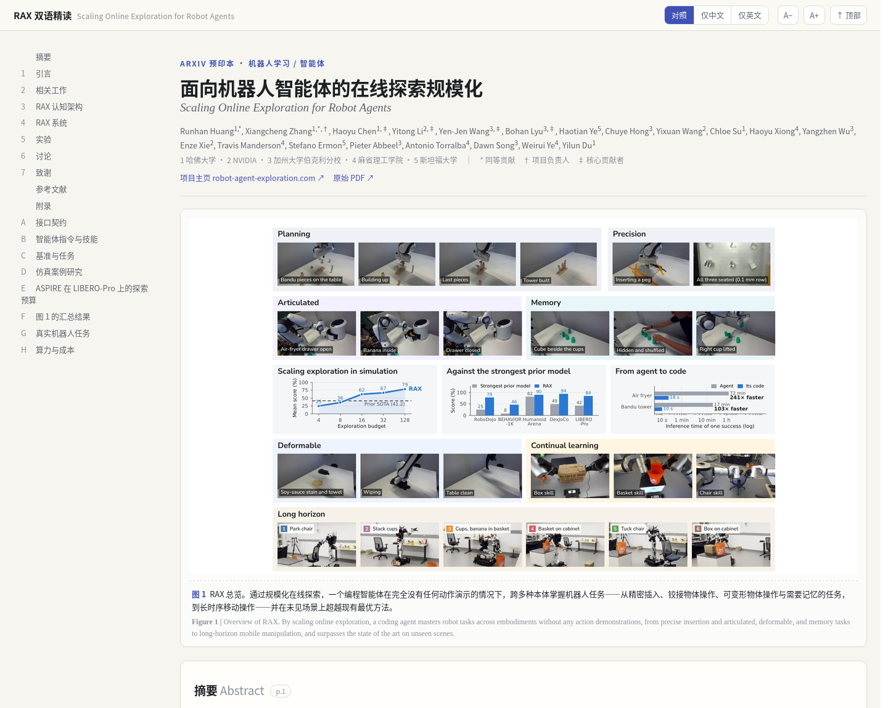
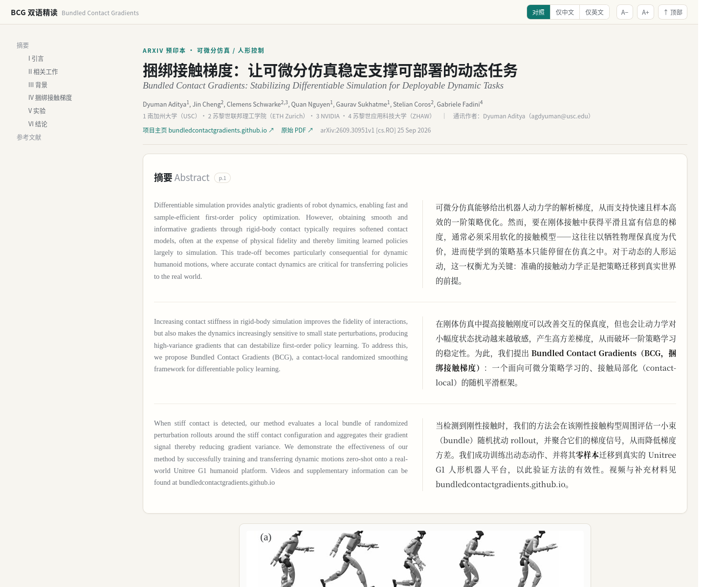

# 机器人论文双语精读 · Robotics Paper Reading

把机器人领域的论文（**软件算法** + **硬件系统**）做成 **逐段中英对照** 的可浏览页面：左英文原文、右中文译文，插图与表格从原 PDF 高清裁出，精编页公式用 KaTeX 本地渲染，批量导入页保留原版公式裁图。支持「对照 / 仅中文 / 仅英文」切换、字号调整、点击放大图片，以及一键打印成双语 PDF。

---

## 预览

| RAX（77 页） | BCG（8 页） |
|---|---|
|  |  |

左列英文原文、右列中文译文；页首可切换「对照 / 仅中文 / 仅英文」，点击图片可放大，左侧目录随滚动高亮。

## 已收录

| 论文 | 方向 | 规模 | 位置 |
|---|---|---|---|
| **Scaling Online Exploration for Robot Agents**（RAX） | 软件 · 智能体 / 机器人学习 · VLA · 操作 | 77 页 · 34 图 · 21 表 · 261 段对照 | [`site/rax/`](site/rax/) |
| **Bundled Contact Gradients: Stabilizing Differentiable Simulation for Deployable Dynamic Tasks**（BCG） | 硬件 · 可微分仿真 · 接触 · 足式/人形 | 8 页 · 5 图 · 2 表 · 1 算法 · 公式 (1)–(5) | [`site/bcg/`](site/bcg/) |

**RAX** 让一个通用编程智能体通过在线探索自行编写机器人控制程序，跨五种本体（单臂 / 双臂 / 灵巧手 / 移动 / 人形）在仿真与真机上完成精密插入、铰接物体、可变形物体与长时序移动操作。
**BCG** 在刚性接触处对邻近扰动分支做局部随机平滑以稳定一阶策略梯度，把可微分仿真训练的人形动态动作零样本部署到真实 Unitree G1。

## 目录结构

```
.
├── sources/                 # 原始 PDF（仅作学习/评注用途）
├── pipeline/                # 可复用工具链
│   ├── build.py             # 配置驱动：content/<id> + template → site/<id>
│   ├── template.html        # 阅读器模板（CSS/JS，{{...}} 占位符）
│   ├── crop.py              # 按 JSON 框位从 PDF 裁图（图/表/算法框）
│   ├── extract_floats.py    # 单栏论文的图表自动检测
│   ├── vendor/katex/        # 本地 KaTeX（离线公式渲染，含 woff2 字体）
│   └── configs/{rax,bcg}.json
├── content/<id>/            # 分节译文源文件（HTML 片段，按文件名排序拼接）
├── site/                    # 成品站点（纯静态，可直接双击打开）
│   ├── index.html           # 入口页
│   ├── rax/{index.html, figs/}
│   └── bcg/{index.html, figs/, vendor/katex/}
└── README.md
```

## 下载与阅读

**方式一（最简单）**：在 GitHub 页面点 **Code → Download ZIP**，解压后双击 `site/index.html`。
全站是纯静态文件，图片与 KaTeX 都在本地，**无需联网、无需服务器**。

**方式二**：`git clone` 后同样双击 `site/index.html`；若想用本地服务器：

```bash
cd robot-paper-reading
python3 pipeline/serve.py
# 浏览器打开 http://127.0.0.1:8000/site/index.html
```

### 数据库评分

需要评分时，使用上面的本机服务打开主页；每项可直接点击 1–5 颗星，再次点击当前分数可清空。页面从数据库读取评分，保存成功后显示“已保存到数据库”。首次打开会将同一访问地址下原有的浏览器评分补入数据库，不覆盖已经保存的评分。

评分持久保存在 `_data/ratings.sqlite3`，重启服务、刷新或更换本机浏览器后仍会读取同一数据库。此目录已被 Git 忽略，不会随 PR 上传。保留该数据库文件即可保留评分；更换电脑时需要自行迁移该文件。本服务仅监听本机地址，不提供跨设备同步。直接双击静态页面仍可阅读，但无法连接数据库评分。

> 原始 PDF 与高清裁图构成主要体积，`sources/` 中的 PDF 供页面内「跳转到原文页码」使用。只想看译文的话，下载后删掉 `sources/` 也不影响阅读，只是页码链接会失效。

## 重新构建

```bash
python3 pipeline/build.py pipeline/configs/rax.json
python3 pipeline/build.py pipeline/configs/bcg.json
```

产物写入 `site/<id>/`。每个 `site/<id>/` 目录自带 `figs/` 与 `vendor/katex/`，可单独拷走。

## 新增一篇论文

1. **放 PDF**：`sources/<name>.pdf`。
2. **写配置** `pipeline/configs/<id>.json`：

   ```json
   {
     "id": "xxx",
     "pdf": "sources/xxx.pdf",
     "title": "中文标题 · 中英对照",
     "brand": "XXX 双语精读",
     "brand_sub": "English Title",
     "accent": "#0f766e",
     "accent_soft": "#e6f4f1",
     "math": true
   }
   ```
   `math: true` 会把 KaTeX 复制进产物目录并启用 `\(...\)` / `\[...\]`。

3. **取文本 / 裁图**：

   ```bash
   pdftotext -f 1 -l N sources/xxx.pdf -        # 逐页文本（双栏按阅读顺序）
   pdftotext -bbox sources/xxx.pdf bbox.html    # 需要坐标时
   python3 pipeline/crop.py --pdf sources/xxx.pdf \
       --spec floats.json --out site/xxx/figs --dpi 200
   ```
   `floats.json` 里每项为 `{"name","page","x0","y0","x1","y1"}`（单位 pt，原点在页面左上角）。

4. **写译文** `content/xxx/00_front.html`、`01_intro.html`…… 每段一对：

   ```html
   <h2 data-num="1">1&nbsp;&nbsp;中文标题<span class="en-h">English Title</span>
       <a class="pg" href="{{PDF}}#page=5" target="_blank">p.5</a></h2>

   <div class="pair">
     <p class="en">English paragraph…</p>
     <p class="zh">中文段落…</p>
   </div>
   ```
   - 显示公式：`<div class="eq">\[ ... \tag{1} \]</div>`
   - 单栏图限宽：`<figure class="float narrow">`；通栏图用 `figure.float`
   - `{{PDF}}` 由构建脚本替换为指向 `sources/` 的相对路径

5. **构建**：`python3 pipeline/build.py pipeline/configs/xxx.json`。

### 约定

- **切分粒度**：一个原文自然段 = 一个 `.pair`；跨页断开的段落合并；题注、表注与正文一样成对翻译。
- **专名**：方法名（RAX、BCG、SHAC、ADD…）、代码标识符与变量名保留英文；术语首现用「中文（English）」。
- **参考文献**：保留英文原貌，双栏排版，便于按原文检索。
- **代码清单 / 算法框**：保留英文与原始缩进，仅翻译说明文字。


## 本地论文库导入

已从 `paperlearning` 导入去重后的 **24 份 PDF，共 370 页**：23 篇英文论文和 1 篇中文资料；原有 RAX、BCG 精编页继续保留。首页不再展示“计划中”。完整清单与原始文件哈希见 `content/library-manifest.json`，同一 PDF 在原目录的重复位置保存在各篇配置的 `source_aliases` 中。

**译文状态**：这批 23 篇英文论文的 3,349 段译文，已经通过本机 Antigravity CLI 使用 **Gemini 3.8 Flash（Medium）**（模型 ID `gemini-3.8-flash-medium`，`--effort medium`）逐段对照英文重译与润色。尚未经过逐段人工校对。每篇 `content/<id>/polish_provenance.json` 保存批次、会话、token 使用和调用记录的校验摘要；完整结果按段落 ID 校验后才应用。数学公式与图表继续使用原 PDF 裁图；无法确定的行内数学缺损明确标记为“行内公式见原版”，请对照原图或 PDF 核对。参考文献及原中文资料保留原貌。

- 每页按阅读顺序组织为中英对照，原始 PDF、段落裁图和整页图均可离线查看。
- 显示公式、插图、表格按原始 PDF 裁出，公式不重新生成编号。
- 页面提供原始编号公式索引；正文中的明确公式引用可点击跳转，公式下方可返回引用处。
- 对重复编号，目标包含页面标识，并按引用位置选择相邻的公式；子公式编号也保留。
- `content/<id>/document.json` 保存文本、译文、页码、原始框位和公式标签；HTML 片段及 `site/<id>/` 为可重建产物。

只重新构建现有内容（Python 标准库即可，无需翻译模型或 API Key）：

```bash
python3 pipeline/import_library.py --rebuild
python3 pipeline/build.py pipeline/configs/rax.json
python3 pipeline/build.py pipeline/configs/bcg.json
python3 pipeline/build_index.py
python3 pipeline/verify_library.py
```

如需重新生成最初的离线草稿（会覆盖当前润色结果），可使用原导入工具；通常只需前述重新构建命令。以下依赖和模型仅用于离线草稿导入：

```bash
python3 -m venv _work/import-env
_work/import-env/bin/pip install -r pipeline/requirements-import.txt
# 下载 https://argos-net.com/v1/translate-en_zh-1_9.argosmodel
# 将 ZIP 格式模型包解压到 _work/models/，不要提交模型或虚拟环境。
_work/import-env/bin/python pipeline/import_library.py \
  --library /path/to/paperlearning \
  --model _work/models/translate-en_zh-1_9
_work/import-env/bin/python pipeline/refine_library.py \
  --model _work/models/translate-en_zh-1_9
python3 pipeline/build_index.py
python3 pipeline/verify_library.py
```

批量工具也支持 `--only <id> ...` 分批运行；中间翻译缓存保存在被忽略的 `_work/`。新增其他论文前，需在 `pipeline/import_library.py` 的 `PAPERS` 中补充文件名、ID、中文标题和分类。

Argos / OPUS-MT 仅用于最初的离线草稿生成。当前英文译文已由上述 Gemini 模型对照英文重新润色；重新运行离线翻译会覆盖润色结果，操作前请保留备份。原离线模型来自 Jörg Tiedemann 与 Santhosh Thottingal 的 OPUS-MT（CC BY 4.0）；模型文件不随仓库发布。

### 使用指定 Gemini 模型继续润色

需要本机已登录的 `agy` CLI 且能调用 `gemini-3.8-flash-medium`。批量调用固定该模型及 medium，不做模型回退。运行目录和调用结果放在被忽略的 `_work/` 中，不保留旧译文备份。页面上的模型标记只在整批成功校验并应用后更新。

```bash
# 为新一轮润色选择一个全新的目录；已有目录直接续跑，不重复 prepare。
python3 pipeline/antigravity/prepare_jobs.py --repo . --run-dir _work/gemini-next
export RPR_GEMINI_RUN_DIR="$PWD/_work/gemini-next"
python3 pipeline/antigravity/run_batches.py --limit 10000 --workers 8
python3 pipeline/antigravity/apply_results.py
python3 pipeline/antigravity/update_docs.py
python3 pipeline/antigravity/commit_results.py
```

`apply_results.py` 仅生成已校验的暂存内容；`commit_results.py` 验证全文覆盖和源文件哈希后应用，并运行资源/公式引用检查；校验成功后不保留旧译文备份。任一批次不完整或未成功返回时，整批应用会被拒绝。

## English

A bilingual (English ↔ Chinese) reading site for robotics papers — covering both the **software** side (learning, control, agentic robot programming) and the **hardware** side (differentiable simulation, contact modelling, sim-to-real on humanoids).

Each paper becomes a single static page: original English paragraph on the left, Chinese translation on the right, figures and tables cropped at 200 dpi from the original PDF, equations rendered locally with KaTeX in the curated pages or preserved as original PDF crops in the imported library. Toggle between parallel / Chinese-only / English-only, zoom into any figure, or print straight to a bilingual PDF.

## Copyright

- Code, templates and the Chinese translations: **MIT** (see `LICENSE`).
- Papers, figures and tables: © their original authors. They are included for study and commentary only, and will be removed promptly upon request (see `NOTICE.md`).
